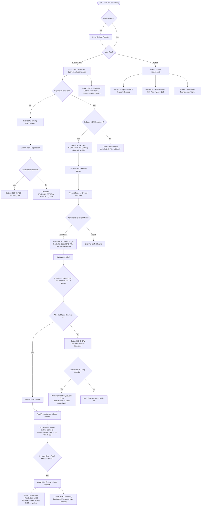

# Paradesk Core Engine — Multi-Event Ground Execution & Capacity-Recovery Portal
**Engineered for Technical Hackathons & Coding Competitions at IIT Madras (Paradox '27)**

---

## 1. Overview & Operational Problem Solved

Collegiate technical hackathons and competitive coding battles held at IIT Madras (across the Central Research Complex, CRC) experience two acute operational bottlenecks:

1. **The Registration Drop-Off & "Frozen Table" Bottleneck:**  
   Historically, **20% to 30% of pre-registered teams fail to show up physically** on the day of the event. Organizers hesitate to give away vacant desks, wondering if teams are running late. As a result, expensive venue capacity, high-wattage power strips, and Gigabit LAN drops remain frozen for absent squads, while enthusiastic campus walk-ins and waitlisted students wait outside in the lobby.
2. **Disconnected Event Logistics:**  
   Raw Google Form registration spreadsheets remain disconnected from physical table allocations, ground verification passes, problem statement releases, marking rubrics, and the live leaderboard.

**Paradesk** acts as the single operational bridge between raw registrations and live on-campus execution. It automates First-Come-First-Served (FCFS) desk allocations, manages an active Top-10 Standby queue in the venue lobby, executes an atomic 15-minute table reclamation protocol, unlocks digital check-in passes 24 hours prior to kickoff, and powers a live leaderboard with an automated 2-hour freeze window.

---

## 2. End-to-End Workflow & Decision Tree (Yes / No Logic)

The diagram below outlines the complete lifecycle of an event in Paradesk, from participant sign-up and 24-hour token unlocking to ground verification, 15-minute desk reclamation, and the 2-hour leaderboard freeze:



---

## 3. Screen-by-Screen Guide

Paradesk is built with a **clean white & slate color palette** (`bg-white`, `bg-slate-50`, `border-slate-200`, `text-slate-900`) with emerald, amber, and rose status badges. **Strictly no distracting blue gradients.**

### Screen 1: Authentication Gateway (`/login` & `/register`)
- **Sign In Card:** Clean login form with email and password fields.
- **1-Click Quick Demo Accounts:**
  - `Admin Demo` (`admin@iitm.ac.in` / `admin123`)
  - `Participant Demo` (`aarav@smail.iitm.ac.in` / `participant123`)
  - `Standby Lead Demo` (`vikram@smail.iitm.ac.in` / `participant123`)
- **Participant Registration (`/register`):** Collects Full Name, College Email, Phone, and Password, automatically authenticating the student.

---

### Screen 2: Participant Personal Dashboard (`/participant/dashboard`)
Designed specifically for student squads:
- **My Registered Events:**
  - **Check-in Token Card (24-Hour Rule):**
    - **Within 24 Hours (Event 1):** Unlocked view displaying the unique check-in code (e.g. `PX-CRC01`), assigned desk (`CRC-T01`), and mock barcode ready for ground verification.
    - **More Than 24 Hours Away (Event 2):** Padlock badge: *"Check-in code unlocks 24 hours before kickoff"*.
- **Squad Roster Management:**
  - Displays team name, lead contact, and list of members.
  - **"Edit Squad Details" Modal:** Easily swap team members, update phone numbers, and change team names before kickoff.
- **Judging & Evaluation Status:**
  - Initially displays *"Evaluation Pending"* (as hackathon participants do not have pre-populated scores at kickoff).
  - Displays Innovation (40), Technical Complexity (35), and Presentation (25) scores once evaluated by judges.
- **Resources & Documentation:**
  - Problem Statement brief with official PDF download link.
  - Evaluation criteria & weightage rubric table.
- **Upcoming Events Open for Registration:**
  - Lists next week's competitions with a simple **"Register Team"** modal.
  - Automatically places teams in the standby queue if the hall is at full capacity, without exposing internal table mechanics on the form.

---

### Screen 3: Lead Participant Digital Boarding Pass (`/portal/{unique_checkin_token}`)
- Mobile-first, shareable digital pass accessible via unique token link.
- **Dynamic Status Callouts:**
  - `ALLOCATED`: Displays reserved table number (`CRC-T01`) and the 15-minute cutoff warning.
  - `STANDBY_TOP10`: Displays exact queue rank (e.g., `Standby Priority #1`) and directs the squad to report to the CRC Lobby for immediate seat reclamation.
  - `CHECKED_IN`: Confirmed seated badge with active LAN and power telemetry.
  - `NO_SHOW`: Notifies squad that their desk was reclaimed due to non-reporting.

---

### Screen 4: Admin Ground Operations Command Center (`/dashboard`)
- **Restricted Access:** Strictly protected by role-based guards; participants attempting to access this route are redirected to their portal.
- **Multi-Event Switcher:** Seamlessly switch between concurrent events (e.g., *HackParadox 2027* in CRC 101 vs *AlgoStrike Battle* in CRC 202).
- **Venue & Timing Editor:**
  - **"Edit Venue & Timing" Modal:** Update event name, venue hall, kickoff date/time, team capacity, problem statements, and rubrics.
- **Ground Verification & Desk Allocator:**
  - Input field to scan barcodes or enter 6-character check-in tokens. Confirms team arrival and binds the physical table.
- **15-Minute No-Show Sweeper:**
  - 1-click trigger to mark unverified teams as `NO_SHOW`, reclaim tables, and automatically promote Top-10 Standby teams in queue order.
- **Email Dispatch & Broadcast Center:**
  - Dispatches automated campaigns:
    1. *Broadcast 24h Check-in Passes* (to allocated desks).
    2. *Urgent Standby Lobby Call* (to Top-10 queue squads).
    3. *Venue Access, Power Banks & LAN Drop Guide*.
    4. *Custom Announcement*.
  - Outbox history table records timestamps, recipient counts, and delivery states.

---

### Screen 5: Physical Venue Floorplan Matrix
- Visual grid representing every table in the hall (`CRC-T01` to `CRC-T30`):
  - **Emerald:** Checked-in & verified seated.
  - **Slate:** Allocated (pending arrival).
  - **Dashed White:** Vacant / reclaimed.
- **Hover Popover:** Displays team name, leader, phone number, and check-in token for fast ground coordination.

---

### Screen 6: Live & Frozen Public Leaderboard (`/leaderboard/{event_id}`)
- **Podium Cards:** Gold (Rank 1), Silver (Rank 2), and Bronze (Rank 3) highlight cards.
- **Standings Table:** Breakdown of Innovation (40), Technical (35), Presentation (25), and Total Score (100).
- **2-Hour Leaderboard Freeze Window:**
  - **Public View:** When frozen, displays a prominent lock banner (*"Leaderboard Frozen: 2-Hour Cutoff Window"*) and masks scores to maintain suspense for the closing ceremony.
  - **Admin View (`?admin=1`):** Organizers and judges retain live unmasked telemetry backstage.

---

## 4. Pre-Configured Demo Accounts

| Role | Email | Password | Access & Experience |
|---|---|---|---|
| **Administrator** | `admin@iitm.ac.in` | `admin123` | **Full Admin Console:** View all 35 teams, floorplan matrix, verify check-in tokens, run 15-min sweep, edit venue/timing, dispatch emails. |
| **Participant (Allocated)** | `aarav@smail.iitm.ac.in` | `participant123` | **Team:** `NeuralForge` (Desk `CRC-T01`). Event is today in 2h, so check-in code `PX-CRC01` is **ACTIVE & UNLOCKED**. |
| **Participant (Standby)** | `vikram@smail.iitm.ac.in` | `participant123` | **Team:** `CodeVanguard` (Queue #31, Standby Priority #1). Lobby standby pass active. |

---

## 5. Mock Events & Seed State

The database initializes with two realistic event scenarios:

1. **Event 1: "HackParadox 2027" (Today's Event — Starts in 2 Hours)**
   - **Hall Capacity:** 30 tables (`CRC-T01` to `CRC-T30`).
   - **Registrations:** Exactly **30 allocated teams** + **5 teams in the standby queue** (Total: 35 teams).
   - **24-Hour Code Visibility:** `< 24 hours` $\rightarrow$ Check-in codes are **unlocked & visible** for ground scanning.
   - **Initial Scores:** All teams initialize with **`0.0` points** (status: *Evaluation Pending*).
2. **Event 2: "AlgoStrike Coding Battle" (Next Week's Event — Starts in 7 Days)**
   - **Hall Capacity:** 20 tables (`ALGO-T01` to `ALGO-T20`).
   - **24-Hour Code Visibility:** `> 24 hours` $\rightarrow$ Check-in codes are **locked** until 24 hours prior to kickoff.
   - **Registration:** Visible under *Upcoming Events* for participants to sign up.

---

## 6. Technical Architecture & Database Schema

- **Backend:** Python 3.10+ with **FastAPI**
- **Session Security:** `PureCookieSessionMiddleware` utilizing Python standard library **HMAC-SHA256** signatures (`hmac`, `hashlib`, `base64`, `json`, `SimpleCookie`). Zero external dependency on `itsdangerous`.
- **Database:** **SQLite3** with Write-Ahead Logging (`PRAGMA journal_mode=WAL;`), enforcing row-level concurrency and foreign key constraints.
- **Frontend:** Server-rendered **Jinja2 Templates** styled with **Tailwind CSS CDN** + **Font Awesome**.

### Schema Summary:
- **`users`:** `id`, `email`, `password_hash`, `full_name`, `role` (`ADMIN` / `PARTICIPANT`), `phone`, `created_at`.
- **`events`:** `id`, `name`, `slug`, `max_teams`, `max_members_per_team`, `venue_name`, `event_start`, `problem_statement_url`, `problem_statement_text`, `rubric_json`, `freeze_hours_before_end`, `is_leaderboard_frozen`.
- **`desks`:** `id`, `event_id`, `desk_code`, `is_occupied`, `assigned_team_id`.
- **`teams`:** `id`, `event_id`, `user_id`, `team_name`, `lead_name`, `lead_email`, `lead_phone`, `member_count`, `member_names`, `registration_timestamp`, `queue_position`, `status` (`ALLOCATED`, `STANDBY_TOP10`, `WAITLISTED`, `CHECKED_IN`, `NO_SHOW`), `unique_checkin_token`, `assigned_desk_id`, `checkin_timestamp`, `score_innovation`, `score_technical`, `score_presentation`, `total_score`.
- **`emails_sent`:** `id`, `event_id`, `subject`, `recipient_count`, `recipient_type`, `body_preview`, `sent_timestamp`, `status`.
- **`audit_logs`:** `id`, `event_id`, `timestamp`, `action`, `details`, `badge_color`.

---

## 7. Production Deployment & Local Setup

### Deploy on Hugging Face Spaces (Zero-Docker, Free Tier & No Sleep)

Hugging Face Spaces runs on free 2 vCPU / 16GB RAM instances and does not sleep aggressively like other free PaaS providers:

1. Go to **[huggingface.co/new-space](https://huggingface.co/new-space)**.
2. Enter Space name: `paradesk` (or your choice).
3. Select **Gradio** as the Space SDK *(No Docker required)*.
4. Visibility: **Public**.
5. Click **Create Space**.
6. Connect or push your code:
   - **Method A (Direct Git Push to Hugging Face):**
     ```bash
     git remote add space https://huggingface.co/spaces/<YOUR_USERNAME>/paradesk
     git push space main
     ```
   - **Method B (Duplicate / Sync from GitHub):**
     In Space Settings, choose *Sync with GitHub* and connect `https://github.com/amitshivhare7879/Paradesk.git`.
7. Hugging Face installs `requirements.txt` and executes `app.py`. Your full FastAPI Paradesk application is immediately live at:
   - `https://<YOUR_USERNAME>-paradesk.hf.space`

---

### Running Locally
```powershell
# 1. Install dependencies
pip install -r requirements.txt

# 2. Launch application
uvicorn app:app --reload
```
Open **http://127.0.0.1:8000** in your browser.

### Docker & Container Deployment
```bash
# Build and run with persistent storage
docker compose up -d --build

# Check health endpoint
curl http://localhost:8000/health
```

### Cloud Platforms (Render, Railway, Heroku, Fly.io)
- **`Procfile`:** `web: uvicorn app:app --host 0.0.0.0 --port ${PORT:-8000}`
- **`render.yaml`:** Pre-configured Infrastructure-as-Code Blueprint with auto-deploy and health checks.

---

## 8. Automated Verification Suite

Run all 10 automated test suites covering authentication, 24-hour code unlock logic, ground check-in, 15-minute sweep, and the `/health` endpoint:

```powershell
python direct_test.py
```

**Output:**
```
[TEST 1] Initializing fresh database with users and seed events...
  [OK] Admin and Participant users created with verified roles.
  [OK] Event 1 'HackParadox 2027' (Today) and Event 2 'AlgoStrike Coding Battle' (Next Week) provisioned.
  [OK] Event 1 has exactly 30 desks, 30 allocated teams, and 5 in the standby queue (Total = 35 teams).
[TEST 2] Testing Authentication Gateway (Login & Registration)...
  [OK] Invalid credentials safely rejected.
  [OK] Admin login succeeded, established session with role 'ADMIN'.
  [OK] Participant login succeeded, established session with role 'PARTICIPANT'.
  [OK] New participant registered and automatically authenticated.
[TEST 3] Testing Participant Dashboard & 24-Hour Code Visibility Rule...
  [OK] Participant portal for today's event correctly displays unlocked check-in code and assigned desk.
[TEST 4] Testing Participant Team Roster Update...
  [OK] Participant updated team details and member names successfully.
[TEST 5] Testing Event Registration & Capacity Overflow Queue...
  [OK] Full event automatically placed new registration into Queue Position #36 (STANDBY_TOP10).
[TEST 6] Testing Admin Dashboard & Event Details Editing...
  [OK] Admin Dashboard rendered cleanly with floorplan and capacity gauges.
  [OK] Admin updated event title, venue, and timing successfully.
[TEST 7] Testing Email Notification Dispatch System...
  [OK] Dispatched email broadcast to 30 recipients.
[TEST 8] Testing Ground Check-In by Code & Desk Assignment...
  [OK] Ground check-in successfully verified 'SyntaxSquad' via code 'PX-CRC06'.
[TEST 9] Testing 15-Minute Sweep Protocol Promoting Standby Top-10...
  [OK] 15-minute sweep swept 24 no-shows and promoted standby team 'CodeVanguard' into a reclaimed desk!
[TEST 10] Testing Production Health Check Endpoint...
  [OK] /health endpoint returned 200 OK with database connection verified.

=================================================================
ALL 10 TEST SUITES PASSED! DEPLOY-READY & PRODUCTION HARDENED.
=================================================================
```

---

## 9. Companion Documentation

- **`TASK_2_2_DROP_OFF_SOLUTION.md`:** Strategic operations blueprint covering the 5 root causes of collegiate hackathon drop-offs and the multi-phase technical engagement flow.
- **`google_sheets_apps_script.js`:** Google Sheets companion automation script for form ingestion, 48-hour hard RSVPs, and standby broadcasts.
